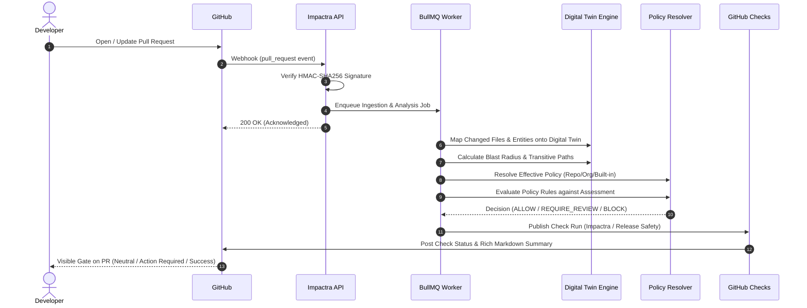

# Impactra

### AI-Powered Software Change Intelligence & Release Safety Platform

[](https://github.com/impactra/impactra/actions/workflows/ci.yml)
[](https://github.com/impactra/impactra)
[](https://nodejs.org/)
[](https://pnpm.io/)
[](https://www.typescriptlang.org/)
[](#license)

---

## Product Summary

**Impactra** is an enterprise-grade software change intelligence and release safety platform designed to analyze software changes **before deployment**. Rather than treating pull requests as isolated diffs of text lines, Impactra reconstructs a live **Software Digital Twin** of your entire system topology. By projecting change sets onto this graph model, Impactra calculates the exact architectural blast radius, uncovers hidden transitive coupling, detects breaking schema and API drift, evaluates multi-factor release risk, and enforces customizable release policies directly through automated GitHub release gates.

---

## The Problem

Modern software development moves at high velocity through distributed services, shared libraries, and continuous delivery pipelines. Yet the tooling used to evaluate changes before merging remains fragmented:

1. **Hidden Coupling & Blast Radius:** A seemingly innocent signature change or utility tweak in a shared package cascades to break unmonitored downstream services or asynchronous background workers.
2. **Silent API & Schema Drift:** Breaking alterations in REST contracts, database schemas (column drops, type shifts, lock-inducing migrations), or configurations pass linting and unit tests unnoticed.
3. **Subjective Release Decisions:** Release managers and tech leads lack an objective, deterministic measure of release safety, relying on intuition or rubber-stamp approvals.
4. **Unenforced Policy Governance:** Governance rules (e.g. "require security review for core package modifications" or "block deployments affecting more than 15 services") exist only in team wikis without automated pipeline enforcement.

---

## The Solution

Impactra transforms pull request evaluation from guesswork into a deterministic engineering discipline:

- **Deep AST Parsing & Digital Twin Ingestion:** Parses source trees, package manifests, and service configurations to maintain a topological graph of software entities and relationships.
- **Transitive Blast Radius Traversal:** Computes multi-hop ripple effects with cycle-safe graph traversal algorithms, identifying all directly and indirectly impacted services.
- **Multi-Factor Risk Scoring:** Synthesizes code diffs, architectural boundaries, security signals, database migrations, and test impact into a deterministic 0–100 risk score.
- **Hierarchical Release Policies:** Enables organizations to configure custom, versioned release policies with safe glob matching, non-mutating preview capabilities, and immutable audit ledgers.
- **Two-Person Approval & Exception Workflows:** Incorporates peer review governance, self-approval prevention, and break-glass exception workflows for blocked releases.
- **Automated GitHub Release Gates:** Posts an inline GitHub Check Run (`Impactra / Release Safety`) to enforce deployment gates without developer context switching.

---

## Key Features

- **Software Digital Twin Engine:** Reconstructs structural and behavioral relationships across services, modules, database tables, message queues, and API routes.
- **Deterministic Blast Radius Analysis:** Configurable traversal depth (up to 50 hops) and affected node limits with deterministic deduplication and evidence path reconstruction.
- **Composite Release Safety Scoring:** Evaluates changes across 5 standardized severity levels (`LOW`, `MEDIUM`, `HIGH`, `CRITICAL`) and 4 action decisions (`ALLOW`, `REQUIRE_REVIEW`, `BLOCK`, `EXCEPTION_GRANTED`).
- **Flexible Precedence Policy Resolution:** Evaluates policies across a 5-tier specificity hierarchy: Repository Branch &rarr; Repository Default &rarr; Organization Branch &rarr; Organization Default &rarr; Built-in Fallback.
- **Safe Policy Preview:** Allows architects and leads to preview hypothetical policy evaluations against historical pull requests without mutating database state.
- **Audit Ledger & Accountability:** Immutable, append-only event logs for all release policy modifications and approval decisions.
- **Multi-Tenant RBAC Governance:** 9 canonical enterprise roles (`OWNER`, `ADMIN`, `ARCHITECT`, `SECURITY_ENGINEER`, `DEVELOPER`, `RELEASE_MANAGER`, `QA_ENGINEER`, `AUDITOR`, `VIEWER`).
- **Dual Deployment Architecture:** Native support for both local development (Docker Compose) and cloud production (multi-stage Docker, Nginx/Caddy reverse proxy, S3-compatible storage, SSL/TLS).

---

## System Architecture

```mermaid
flowchart TD
    subgraph GitHubEcosystem ["GitHub Ecosystem"]
        Dev["Developer / PR Author"]
        GHR["GitHub Repository"]
        GHApp["Impactra GitHub App"]
        GHCheck["GitHub Check Run<br/>(Impactra / Release Safety)"]
    end

    subgraph IngressLayer ["Ingress & Reverse Proxy"]
        Proxy["Reverse Proxy (Nginx / Caddy)<br/>SSL/TLS Termination (Ports 80 / 443)"]
    end

    subgraph ImpactraCore ["Impactra Core Platform"]
        API["NestJS API (Port 3001)<br/>Fastify/Express, TypeScript Strict, Swagger"]
        Web["Next.js Workspace (Port 3000)<br/>React 19, Tailwind CSS, App Router"]

        subgraph EngineModules ["Domain Intelligence Engine"]
            Ingest["Change & Repo Ingestion"]
            Twin["Digital Twin Graph Engine"]
            Blast["Blast Radius Analyzer"]
            Safety["Release Safety Engine"]
            Policy["Release Policy Resolver"]
            Approval["Approval & Exception Workflow"]
            CheckPub["GitHub Check Publisher"]
        end
    end

    subgraph PersistenceLayer ["State & Infrastructure"]
        Postgres[("PostgreSQL 17<br/>Prisma ORM, 10 Migrations")]
        Redis[("Redis 7 / BullMQ<br/>Background Workers & Queues")]
        Storage[("Object Storage<br/>MinIO / S3-Compatible")]
    end

    Dev -->|Opens Pull Request| GHR
    GHR -->|Webhooks (HMAC SHA-256)| Proxy
    Proxy -->|/api/* & /github/*| API
    Proxy -->|/*| Web
    Web <-->|REST API + HttpOnly Cookies| API

    API --> Ingest
    Ingest --> Twin
    Twin --> Blast
    Blast --> Safety
    Safety --> Policy
    Policy --> Approval
    Approval --> CheckPub
    CheckPub -->|GitHub App API| GHCheck

    API <--> Postgres
    API <--> Redis
    API <--> Storage
```

---

## How Impactra Works



1. **Repository Onboarding:** Connect a repository via the Impactra GitHub App. Impactra analyzes the repository codebase, AST structures, dependencies, and boundaries to build an immutable snapshot of the Digital Twin.
2. **Pull Request Ingestion:** When a pull request is opened or updated, GitHub delivers an authenticated webhook. Impactra extracts the changed files, diff patches, and AST changes into an immutable ChangeSet revision.
3. **Blast Radius Analysis:** Impactra traverses the Digital Twin graph outwards from the modified entities to discover all affected components, tracking the exact dependency paths.
4. **Release Safety Assessment:** The platform evaluates architectural risk signals, boundary crossings, database migrations, security changes, and test gaps to calculate a risk score (0–100) and severity level.
5. **Policy Resolution & Enforcement:** The assessment is matched against configured release policies following the canonical precedence hierarchy. Rules determine whether the release is auto-approved, requires peer review, or is blocked.
6. **Approval & Exception Workflow:** If review or an exception is required, authorized roles (`RELEASE_MANAGER`, `ADMIN`, `ARCHITECT`) can approve the release or grant a break-glass policy exception with mandatory rationale.
7. **Automated GitHub Check:** The outcome is published directly to the pull request via the GitHub Checks API, preventing merge if safety gates are violated.

---

## Product Screenshots

Impactra provides an intuitive, high-density engineering workspace built for developers, reviewers, and release managers:

### Repository Intelligence & Digital Twin

*Topology overview, package boundaries, entity relationship mapping, and snapshot history.*

### Change Set Inspection

*Pull request revision timeline, AST-level diff breakdown, and changed entity mappings.*

### Blast Radius Analysis

*Multi-hop transitive dependency traversal, affected node breakdown, and evidence paths.*

### Release Safety Radar

*Composite risk score (0–100), risk category signals, and categorized architectural recommendations.*

### Hierarchical Release Policies

*Versioned rule builder, precedence hierarchy resolution, and non-mutating preview modal.*

### Release Approval & Exception Governance

*Two-person review approval, self-approval prevention, break-glass exception modal, and audit ledger.*

### GitHub Release Gate

*Automated GitHub Check Run (`Impactra / Release Safety`) posted directly on GitHub pull request.*

*(Placeholder assets: high-resolution screenshots will be refreshed upon public production deployment.)*

---

## Technology Stack

| Layer | Technologies | Version |
|---|---|---|
| **Frontend Web** | Next.js App Router, React, Tailwind CSS | Next.js 16.4.3 / React 19 |
| **Backend API** | NestJS, Express, Swagger / OpenAPI | NestJS 11 |
| **Monorepo Tooling** | Turborepo, pnpm workspaces, TypeScript strict | pnpm 12.3.4 / TS 5.7.3 |
| **Database & ORM** | PostgreSQL, Prisma ORM (10 applied migrations) | PostgreSQL 17.4 |
| **Cache & Queue** | Redis, BullMQ background worker queues | Redis 7.4.2 / BullMQ 5 |
| **Object Storage** | MinIO / AWS S3 SDK v3 (S3-compatible) | S3 SDK 3.758 |
| **Security & Auth** | Argon2 password hashing, HttpOnly session cookies, Helmet | Helmet 8 / Argon2 0.41 |
| **Reverse Proxy** | Nginx Alpine, Caddy (HTTP/2, SSL/TLS, Let's Encrypt) | Nginx 1.27 / Caddy 2 |
| **Containerization** | Docker, Docker Compose, Multi-stage Alpine images | Node 24.21.0-alpine |

---

## Getting Started

### Prerequisites

- **Node.js:** `^24.21.0` (or `24.x`)
- **Corepack / pnpm:** `pnpm@12.3.4` (`corepack enable && corepack prepare pnpm@12.3.4 --activate`)
- **Docker & Docker Compose:** Docker Desktop or Docker Engine on Linux

### Environment Configuration

Copy the production-ready `.env.example` template:

```bash
cp .env.example .env
```

Edit `.env` to configure your local credentials and preferences.

### Running with Docker (Recommended)

Start the full platform (Web, API, PostgreSQL, Redis, MinIO) in detached mode:

```bash
docker compose up -d --build
```

Verify service status:

```bash
docker compose ps
```

The platform is available at:
- **Web Portal:** [http://impactra.local](http://impactra.local) *(or [http://localhost:3000](http://localhost:3000))*
- **Backend API:** [http://localhost:3001](http://localhost:3001)
- **API Documentation (Swagger):** [http://localhost:3001/api/docs](http://localhost:3001/api/docs)
- **MinIO Console:** [http://localhost:9001](http://localhost:9001)

*(Note for Windows users: Add `127.0.0.1 impactra.local` to `C:\Windows\System32\drivers\etc\hosts` to use `http://impactra.local`)*

### Running for Local Development

To develop directly on the host with hot-module replacement:

```bash
# 1. Install dependencies across workspace
pnpm install

# 2. Build shared contracts and database client
pnpm --filter @impactra/shared build
pnpm --filter @impactra/database build

# 3. Apply database migrations
pnpm --filter @impactra/database exec prisma migrate deploy

# 4. Start all applications in watch mode via Turborepo
pnpm dev
```

---

## Testing & Quality Gates

Impactra maintains strict, automated quality gates across all packages:

```bash
# Run API unit test suite (43 suites, 372 tests)
pnpm --filter @impactra/api test

# Run API E2E test suite (10 suites, 141 tests, zero open handles)
pnpm --filter @impactra/api exec jest --config test/jest-e2e.json --runInBand --detectOpenHandles

# Typecheck all packages
pnpm turbo run typecheck

# Lint all packages
pnpm turbo run lint

# Check production dependencies for security vulnerabilities
pnpm audit --prod

# Check git formatting and whitespace hygiene
git --no-pager diff --check
```

---

## Project Structure

```
Impactra/
├── apps/
│   ├── api/                     # NestJS 11 backend API
│   │   ├── src/                 # Domain modules: auth, changes, blast-radius, release-safety,
│   │   │                        # release-policy, release-approval, github-checks, storage...
│   │   ├── test/                # E2E test suites and controlled fixtures
│   │   └── Dockerfile           # Multi-stage production API image
│   └── web/                     # Next.js 16 App Router frontend
│       ├── src/app/             # Workspace routes, intelligence views, policy manager
│       ├── src/components/      # UI components, layout, navigation, modals
│       └── src/lib/             # Typed API client and helpers
├── packages/
│   ├── config/                  # Shared TypeScript and ESLint configurations
│   ├── database/                # Prisma ORM schema and 10 immutable migrations
│   ├── shared/                  # Shared domain types, contracts, DTOs, and constants
│   └── ui/                      # Shared Tailwind UI primitives
├── deploy/                      # Production deployment configurations
│   ├── nginx/                   # Nginx reverse proxy config & SSL templates
│   └── caddy/                   # Caddy reverse proxy config (auto-HTTPS)
├── docs/                        # Architecture reports, guides, screenshots
│   ├── PRODUCTION_DEPLOYMENT.md # Complete production operations guide
│   ├── PHASE_01B_REPORT.md ... PHASE_12_REPORT.md
│   └── screenshots/             # Product screenshot assets and placeholders
├── scripts/                     # Acceptance verification and utility scripts
├── .github/workflows/           # GitHub Actions CI workflow
├── compose.yaml                 # Local development multi-container stack
├── compose.production.yaml      # Production hardened multi-container stack
└── Dockerfile                   # Multi-stage production Web image
```

---

## Security

Impactra is engineered with defence-in-depth principles:
- **Zero Committed Secrets:** Strict gitignore, automated secret scanning in CI, and synthetic-only configuration templates.
- **Log Sanitization:** Automated sanitization middleware redacts credentials, private IP addresses, bearer tokens, and host filesystem paths before writing to logs.
- **Non-Root Containers:** All runtime containers execute under dedicated unprivileged system users (`nextjs`, `nestjs`).
- **Signature Verification:** All incoming GitHub webhooks are validated using HMAC-SHA256 signatures before processing.
- **CSRF & Origin Protection:** Strict CORS policies and origin verification guards on state-changing authenticated requests.
- **Detailed Security Policy:** See [SECURITY.md](SECURITY.md) for vulnerability reporting guidelines.

---

## Production Deployment

For complete instructions on deploying Impactra to a public Linux VPS, Kubernetes cluster, or container platform with SSL/TLS, see the comprehensive [Production Deployment Guide](docs/PRODUCTION_DEPLOYMENT.md).

Quick production launch with Docker Compose:

```bash
docker compose -f compose.production.yaml up -d --build
```

---

## Contributing

We welcome contributions from the community. Please review [CONTRIBUTING.md](CONTRIBUTING.md) for code conventions, migration rules, and pull request guidelines.

---

## Project Status

Impactra **v1.0.0** marks the successful completion of all 12 major foundational development phases:

- [x] **Phase 01B:** Monorepo Foundation & Premium Live UI Shell
- [x] **Phase 02:** Backend Modular Monolith & Infrastructure Stack
- [x] **Phase 03:** Authentication, Multi-Tenancy & RBAC Foundation
- [x] **Phase 04:** GitHub App Integration & Repository Onboarding
- [x] **Phase 05:** Repository Ingestion & Digital Twin Graph Engine
- [x] **Phase 06:** Pull Request Ingestion & Change Set Engine
- [x] **Phase 07:** Deterministic Blast Radius Analysis Foundation
- [x] **Phase 08:** Deterministic Release Safety Engine & Multi-Signal Scoring
- [x] **Phase 09:** GitHub Checks Integration & Automated Release Gate
- [x] **Phase 10:** Release Approval & Break-Glass Exception Workflows
- [x] **Phase 11:** Release Policy Configuration & Enforcement Foundation
- [x] **Phase 12:** Production Release, Deployment & Project Completion

---

## License

Decision pending prior to public release. See [LICENSE](#license) or repository root for final terms.

---

## Author

**Impactra Engineering Team**
*AI-Powered Software Change Intelligence & Release Safety Platform*
