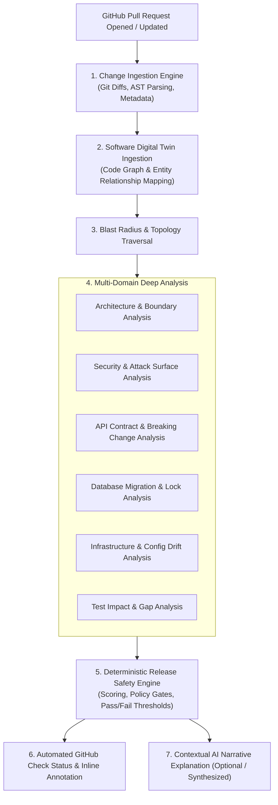

# Project Foundation & Engineering Blueprint

**Project Name:** Impactra  
**Full Title:** Impactra — AI-Powered Software Change Intelligence & Release Safety Platform  
**Document Version:** 1.1.0  
**Phase:** Phase 01B — Monorepo Foundation & Premium Live Impactra UI  

---

## 1. Executive Summary & Product Vision

Modern software engineering moves at breakneck speed, powered by continuous delivery and distributed micro-architectures. However, the tooling used to evaluate code changes before deployment remains fundamentally fragmented. Linters check syntax, CI pipelines run existing tests, and human pull request reviewers skim through multi-hundred-line diffs without visibility into system-wide implications.

**Impactra** solves this critical gap. Impactra is an AI-powered software change intelligence and release safety platform designed to analyze software changes **before deployment**. It constructs an internal **Software Digital Twin** to calculate exact blast radiuses, identify downstream architectural risks, highlight security vulnerabilities, flag breaking API and schema changes, and deliver a deterministic release safety assessment.

---

## 2. The Problem Being Solved

When software engineers open a pull request, critical questions remain unanswered:
1. **Hidden Coupling & Blast Radius:** A seemingly innocent signature tweak in a shared utility library can break downstream services or unmonitored background workers.
2. **Silent API & Schema Drift:** Breaking changes in REST/GraphQL contracts or database schemas (e.g., column drops, type changes, missing indexes) slip through reviews and cause deployment locks or runtime outages.
3. **Security Degradation:** Minor modifications inadvertently expose sensitive endpoints, degrade authentication checks, or introduce dependency vulnerabilities.
4. **Test Gaps:** Test suites pass green, yet the specific paths altered by the change were never exercised by existing tests.
5. **Release Decision Fatigue:** Release managers and tech leads lack an objective, deterministic score of release safety, relying instead on gut feelings or rubber-stamp approvals.

---

## 3. Target Users

- **Software Engineers & PR Authors:** Instant feedback on how changes ripple across the wider codebase, highlighting unconsidered dependencies and missing test coverage.
- **Code Reviewers & Tech Leads:** Accelerated, high-confidence reviews with clear architectural impact maps instead of manual diff hunting.
- **Platform & Release Engineers:** Deterministic gating policies for deployment pipelines to prevent high-risk releases from entering production.
- **Security & Compliance Officers:** Continuous visibility into boundary changes, privilege shifts, and attack surface expansion before deployment.

---

## 4. End-to-End Workflow



---

## 5. The Software Digital Twin Concept

The core architectural asset of Impactra is the **Software Digital Twin**. The Digital Twin is a living graph model representing the structural and behavioral relationships across the target application ecosystem.

### Entities & Relationships Modeled
The Digital Twin explicitly correlates:
- **Source Code Entities:** Functions, methods, classes, interfaces, types, modules, packages, repositories.
- **Service Boundaries:** Internal packages, microservices, background daemons, worker pools.
- **External Interfaces:** REST endpoints, GraphQL schemas, gRPC definitions, webhooks.
- **Data Persistence:** Database tables, columns, indexes, foreign keys, migrations, cache keys.
- **Asynchronous Messaging:** Message queues, topics, event consumers, BullMQ worker processors.
- **Infrastructure & Environment:** Container configs, environment variables, secret bindings, network boundaries, cloud resources.
- **Quality Assurance:** Unit test cases, integration tests, E2E suites, and their code coverage mappings.
- **Deployment Artifacts:** Docker images, release bundles, and target environments.

By maintaining this interconnected graph, Impactra does not treat a Git diff as mere text strings; it projects the change onto the Digital Twin to uncover every downstream node impacted.

---

## 6. Monorepo Architecture (Established in Phase 01B)

Impactra adopts a modular monolith structure using **`pnpm` workspaces** and **`Turborepo`**:

```
Impactra/
├── apps/
│   └── web/                   # Next.js 15, React 19, Tailwind CSS UI application
├── packages/
│   ├── config/                # Shared TypeScript and lint configurations
│   ├── shared/                # Core domain types, risk levels, and capability constants
│   └── ui/                    # Reusable UI primitives (Button, Badge, Card, StatusPill)
├── docs/                      # Architectural and design documentation
├── package.json               # Root scripts and devDependencies
├── pnpm-workspace.yaml        # Workspace package patterns
└── turbo.json                 # Turbo pipeline definitions (build, dev, lint, typecheck)
```

### Monorepo Boundaries:
- `apps/api` (NestJS) and `apps/worker` (BullMQ) are **strictly deferred** to later phases.
- Shared packages provide complete type safety across backend and frontend without duplicate interfaces.
- Zero cyclic dependencies between packages: `apps/web` depends on `@impactra/shared` and `@impactra/ui`, which extend `@impactra/config`.

---

## 7. Security-First Engineering Principles

Impactra analyzes potentially sensitive customer source code and configuration. Security is an uncompromised foundational constraint:

1. **Zero Hostile Code Execution:** Impactra performs **static analysis** and AST parsing. Customer code is **never dynamically executed or evaluated** in an arbitrary runtime environment.
2. **Ephemeral & Minimal Data Retention:** Only structural graph metadata, AST representations, and diff summaries are processed. Sensitive source payloads are retained only as long as necessary for the active analysis session.
3. **Defense in Depth & Least Privilege:** All internal services, database connections, and storage buckets run with granular, least-privilege credentials.
4. **Deterministic Security Policies:** Security analyzer checks (e.g., secret detection, route exposure, privilege changes) operate on strict deterministic rule sets before any generative AI review.
5. **No Blind LLM Ingestion:** Raw proprietary source code is never forwarded to external third-party LLM providers without user consent, token redaction, and strict sanitization.

---

## 8. Deterministic Analysis Before AI Explanation

A foundational rule of Impactra: **Determinism First, AI Second.**

- **Ground Truth is Deterministic:** Code parsing, dependency graph traversal, AST diffing, schema compatibility checks, and policy evaluations are 100% deterministic algorithms with mathematical reproducibility.
- **AI as an Explainer, Not an Oracle:** Generative AI is strictly employed to synthesize human-readable summaries, draft PR explanations, and assist engineers in understanding complex blast-radius graphs.
- **No Hallucinated Release Decisions:** Release safety pass/fail gates and scores must rely strictly on deterministic rules, never on unpredictable non-deterministic LLM generations.

---

## 9. MVP Boundaries & Explicitly Deferred Complexity

To deliver rapid, reliable value, strict phase boundaries are enforced.

### MVP Scope (Phases 1 - 3)
- Ingestion of Git diffs and basic repository structures.
- Core AST parsing for TypeScript/JavaScript ecosystems.
- Basic Digital Twin graph representation in PostgreSQL (using relational / jsonb adjacency models).
- Deterministic blast radius traversal (direct and transitive caller graphs).
- Essential analyzers:
  - Breaking API changes (endpoint signature and response modifications).
  - Database schema changes (destructive column and type modifications).
  - High-risk security markers (hardcoded credentials, exported routes).
- Deterministic release safety scoring engine.
- Developer-centric Web UI displaying change impact, graph topology, and release safety summary.

### Explicitly Deferred Complexity (Out of Scope for MVP)
To avoid unnecessary operational overhead, the following technologies and features are **explicitly forbidden** unless concrete architectural requirements justify them in later phases:
- **No Kubernetes:** Local development uses Docker / Docker Compose. Production orchestration uses standard container services.
- **No Dedicated Graph Databases (e.g., Neo4j):** PostgreSQL with recursive CTEs and relational indexing handles initial graph scales with superior operational simplicity.
- **No Elasticsearch / OpenSearch:** PostgreSQL full-text search and indexed relational queries are sufficient for early exploration.
- **No Dedicated Vector Databases (e.g., Qdrant, Pinecone):** `pgvector` in PostgreSQL will be leveraged if semantic embeddings are needed.
- **No Python Microservices:** The entire core backend will remain unified on modern TypeScript (NestJS/Node.js) for end-to-end type safety and operational efficiency.
- **No Traffic Replay or Dynamic Sandboxes:** No active packet replay or runtime sandbox execution of user code.
- **No Premature Microservices:** No decomposing modules into separate deployment services until scale demands it.

---

## 10. Selected Technology Stack & Versions

| Layer | Technology | Selected Version | Rationale |
| :--- | :--- | :--- | :--- |
| **Monorepo Manager** | `pnpm` Workspaces | `v12.3.4` | Ultra-fast caching, deterministic dependency resolution, strict package isolation. |
| **Build System** | `Turborepo` | `^2.4.2` | High-speed pipeline orchestration, artifact hashing, parallel execution. |
| **Language** | `TypeScript` (Strict Mode) | `^5.7.3` | End-to-end type safety across packages and apps. |
| **Frontend Framework** | `Next.js` (App Router) | `^15.1.7` | Modern server components, fast routing, Node 24 support. |
| **UI Library** | `React` | `^19.0.0` | Concurrent features, modern hooks, first-class server action integration. |
| **Styling** | `Tailwind CSS` | `^3.4.17` | Semantic CSS tokens, design variable consistency, zero runtime CSS overhead. |
| **Iconography** | `lucide-react` | `^0.475.0` | Lightweight, professional SVG iconography for dev tools. |
| **Backend Framework** | `NestJS` | *(Phase 02)* | Enterprise modular structure, dependency injection. |
| **Database** | `PostgreSQL` | *(Phase 02 / Docker)* | Relational integrity, JSONB support, recursive CTE graphs. |
| **Queue / Asynchronous** | `BullMQ` + `Redis` | *(Phase 02 / Docker)* | Resilient distributed background job processing. |

---

## 11. Development Principles

1. **Clean Code & Strict Typing:** No `any` types in production code. Explicit interface contracts for all cross-module interactions.
2. **Zero Inventions Presented as Truth:** The UI and API must never show mock or placeholder data disguised as genuine production results. Empty states must be clearly identified.
3. **Comprehensive Error Handling:** Fail gracefully with descriptive error codes and operational telemetry. Never swallow exceptions.
4. **Idempotent Background Jobs:** All BullMQ worker jobs must be designed to be safely retried without data corruption.

---

## 12. Testing Philosophy

Quality is engineered from the beginning:
- **Unit Testing:** Comprehensive tests for graph traversal algorithms, AST parsers, and policy evaluators using Jest or Vitest.
- **Integration Testing:** Verification of database repositories, Redis queues, and service boundary communication using test containers.
- **End-to-End (E2E) Testing:** Playwright suites to validate critical user workflows (ingesting a change, exploring the Digital Twin, viewing the release safety report).
- **Regression Fixtures:** A permanent suite of real-world pull request diffs and synthetic codebases to verify analyzer consistency across releases.

---

## 13. Documentation Philosophy

- **Living Architecture:** Architecture documentation evolves alongside code. Every major change must include corresponding doc updates.
- **Actionable Runbooks:** Developer onboarding and local reproduction steps must be verified on every environment change.
- **Live Verification Protocol:** Starting from Phase 01B, every release must include a structured `LIVE APPLICATION VERIFICATION` guide.
